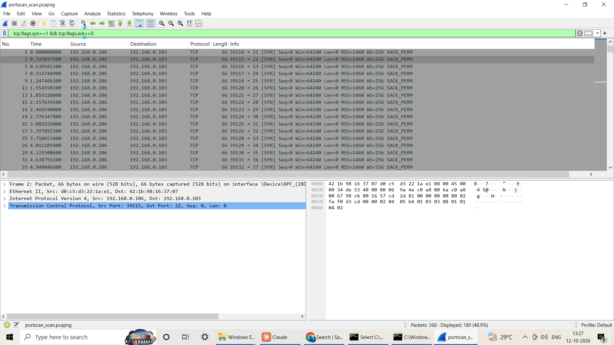
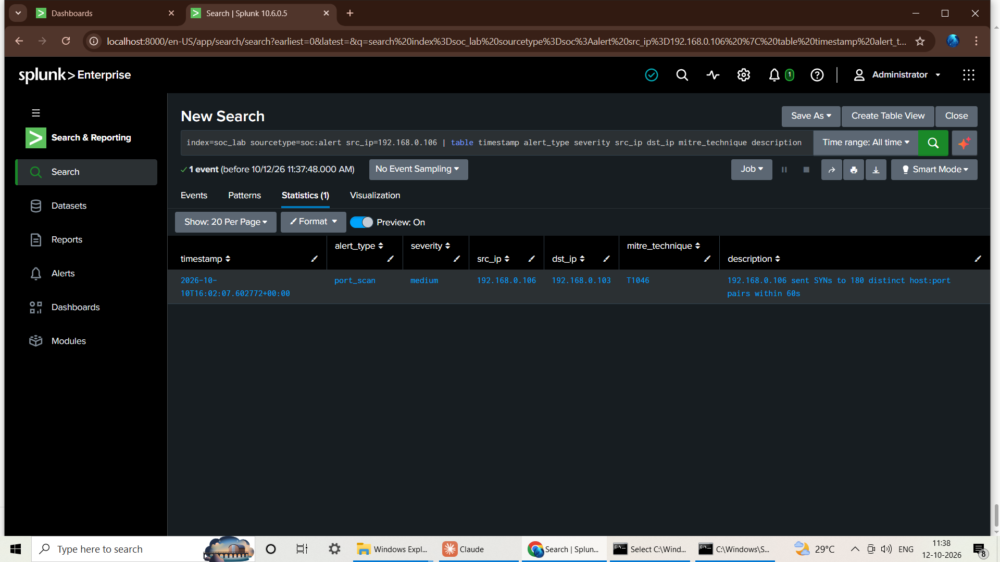
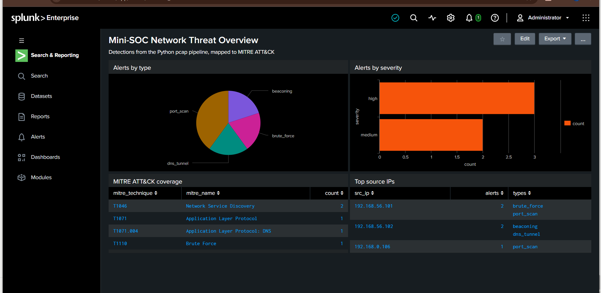

# Mini-SOC: Network Threat Detection Pipeline

A home-lab security operations pipeline. **Wireshark** captures network traffic, **Python (Scapy)** detects attack
patterns in it, and **Splunk** stores, searches, charts and alerts on the results. Detections are mapped to
**MITRE ATT&CK**.

```
 lab devices ──traffic──> Wireshark capture (.pcapng)
                                  │
                    Python detectors (Scapy)
         port scan · brute force · beaconing · DNS tunnel
                                  │  JSON alerts
                  ┌───────────────┴────────────────┐
                  ▼                                ▼
             alerts.jsonl                  Splunk HEC (:8088)
                                                   │
                               SPL searches · dashboard · scheduled alerts
```

## Results on real traffic
I scanned my own phone (`192.168.0.103`) from my PC (`192.168.0.106`) with `tools/simple_scan.py` while capturing in
Wireshark, then ran the capture through the pipeline:

- Wireshark showed one source sending SYN packets to many ports of a single host.
- The Python detector raised: `port_scan  T1046  192.168.0.106 sent SYNs to 180 distinct host:port pairs within 60s`.
- The alert arrived in Splunk and was confirmed with a search.

Full write-up: [`docs/incident_report_port_scan.md`](docs/incident_report_port_scan.md)




## Validation status
| Detector | MITRE ATT&CK | Tested on |
|---|---|---|
| Port scan | T1046 | **Real capture** (my own devices) + unit tests |
| Brute force (ssh/ftp/telnet/rdp/vnc) | T1110 | Synthetic sample + unit tests |
| Beaconing (regular intervals) | T1071 | Synthetic sample + unit tests |
| DNS tunneling (long/high-entropy names) | T1071.004 | Synthetic sample + unit tests |

The synthetic sample is generated by `tools/make_sample_pcap.py` and clearly labelled as sample data. The dashboard
screenshot `docs/screenshots/splunk_dashboard_sample.png` shows the sample alerts plus the one real alert from my scan
(source `192.168.0.106`).



## Quick start (Windows or Linux)
```bash
pip install -r requirements.txt
python tools/make_sample_pcap.py samples/lab_attacks.pcap   # synthetic benign + attack traffic
python -m soc_pipeline analyze samples/lab_attacks.pcap     # expect 4 alerts
python -m pytest                                            # expect 11 passed
```

## Send alerts to Splunk
1. In Splunk Enterprise create an index named `soc_lab` (Settings > Indexes).
2. Enable HTTP Event Collector (Settings > Data inputs > HTTP Event Collector > Global Settings), then create a token
   that is allowed to write to `soc_lab`.
3. Set the token in your terminal (never commit it) and run with `--splunk`:
```
set SPLUNK_HEC_TOKEN=<your-token>          (Windows cmd)
python -m soc_pipeline analyze capture.pcapng --splunk
```
4. In Splunk run `splunk/searches.spl` and import `splunk/dashboard.xml` (Dashboards > Create New > Classic > Source).

## Reproduce the real test (own devices only)
1. Start a Wireshark capture on your Wi-Fi interface.
2. Run `python tools/simple_scan.py <IP of another device you own>` (private IPs only; the script refuses public ones).
3. Stop the capture, save it, and run `python -m soc_pipeline analyze <file>`.

## Repository layout
```
soc_pipeline/   parser.py (pcap -> records), detectors.py, splunk_hec.py, cli.py
tools/          make_sample_pcap.py (synthetic traffic), simple_scan.py (lab port scan)
tests/          pytest unit tests for each detector (true and false positive cases)
splunk/         SPL searches, dashboard XML, scheduled alerts, optional docker-compose
docs/           lab setup, Wireshark filters, tuning log, incident report, screenshots
samples/        synthetic sample pcap and resulting alerts
```

## Limitations
- Detectors are simple threshold rules; slow or randomized activity can evade them.
- Only the port scan detector has been validated on real traffic so far.
- Not a replacement for production tools such as Zeek or Suricata.

## Roadmap
- [ ] Validate brute force, beaconing and DNS tunneling detectors on real lab traffic
- [ ] Tune thresholds against baseline traffic and record results in `docs/tuning_notes.md`
- [ ] Isolation Forest anomaly detector
- [ ] GitHub Actions to run the tests

## Ethics and safety
Scans and attack simulations are run only against devices I own. Do not scan networks or devices you do not own.
Do not publish full captures from a shared or home network; share only trimmed captures of your own lab traffic.
