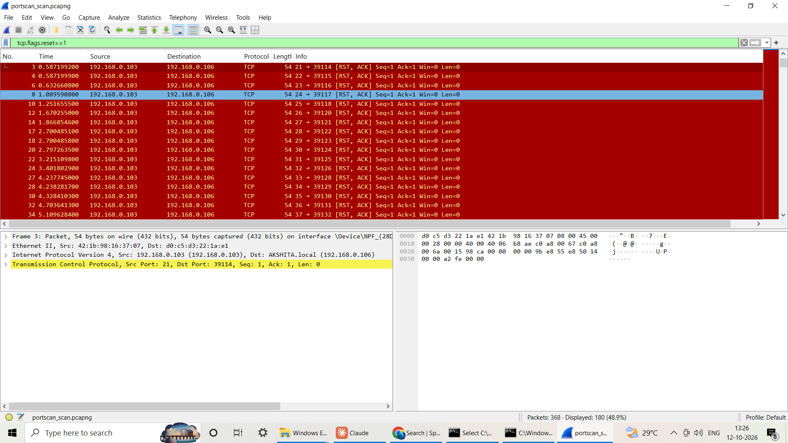

# Incident Report: Internal Port Scan Against a Mobile Device (Lab Simulation)

**Report date:** 10 October 2026
**Analyst:** N Akshitha
**Severity:** Medium
**Status:** Closed. Authorized test on my own devices; no compromise.

> **Scope note.** This was a controlled simulation on my own home network. I deliberately scanned my own phone
> to validate the detection pipeline. It is written as a SOC-style incident report to practice the format.

## 1. Executive summary
On 10 October 2026 at about 16:02 UTC (21:32 IST), host `192.168.0.106` sent TCP SYN packets to 180 distinct
ports on `192.168.0.103` within a 60-second window. The Mini-SOC Python detector flagged this as a port scan
(MITRE ATT&CK T1046, Network Service Discovery) and forwarded the alert to Splunk, where it was confirmed with
a search. The activity was a scan I ran myself against my phone. No systems were compromised.

## 2. Detection
- **How detected:** `detect_port_scan()` in `soc_pipeline/detectors.py`, run on a Wireshark capture of the traffic.
- **Rule:** one source sends SYN-only packets to 20 or more distinct host:port pairs within a 60-second sliding window.
- **Observed:** 180 distinct host:port pairs within 60 seconds.
- **First alert (UTC):** 2026-10-10T16:02:07Z

| Field | Value |
|---|---|
| alert_type | port_scan |
| severity | medium |
| src_ip | 192.168.0.106 (PC running the scan) |
| dst_ip | 192.168.0.103 (phone) |
| mitre_technique | T1046 |
| description | 192.168.0.106 sent SYNs to 180 distinct host:port pairs within 60s |

## 3. Timeline
| Time (UTC) | Time (IST) | Event |
|---|---|---|
| 16:02:07 | 21:32:07 | First SYN of the scan observed (alert `first_seen`) |
| about 16:20 | about 21:50 | Capture exported (368 of 845 packets, filter `ip.addr==192.168.0.103`) and analyzed |
| about 16:21 | about 21:51 | Alert sent to Splunk (`index=soc_lab`, `sourcetype=soc:alert`) and confirmed by search |

## 4. Technical analysis
**How the scan was produced.** `tools/simple_scan.py`, a TCP connect scan (0.3 s timeout per port) run from
`192.168.0.106` against `192.168.0.103`. The capture contains probes to ports 21 to 200, which is 180 distinct ports.
**Open ports found on the phone: none.** All 180 SYN probes were answered with `RST, ACK` (180 of 180), and no `SYN, ACK` reply appears.

**Packet-level evidence (Wireshark, Wi-Fi interface).**
- Filter `tcp.flags.syn==1 && tcp.flags.ack==0`: one source IP sending SYN packets to many different destination ports on a single host.
- Filter `tcp.flags.reset==1`: reset replies from the target, which Wireshark highlights in red, consistent with closed ports refusing connections.




**Splunk confirmation.**
```
index=soc_lab sourcetype=soc:alert | table timestamp alert_type severity src_ip dst_ip mitre_technique description
```


## 5. MITRE ATT&CK mapping
| Tactic | Technique | Evidence |
|---|---|---|
| Discovery | T1046 Network Service Discovery | Many SYN probes from one host to many ports on another host in under a minute |

## 6. Indicators
| Type | Value | Context |
|---|---|---|
| Source IP | 192.168.0.106 | Internal host performing the scan (lab PC) |
| Target IP | 192.168.0.103 | Internal host scanned (phone) |
| Behavior | 180 distinct destination ports in 60 s | SYN-only connection attempts |

## 7. Assessment and root cause
In a real environment, an internal host scanning its neighbors is a common early step after a compromise or by
an insider. Here the cause was my own authorized test. The scan was possible because nothing on the home network
restricts one device from probing another.

## 8. Response (what would be done in a real incident)
1. Identify the scanning host and its owner from the source IP.
2. Check what the host was running and whether it is compromised (processes, recent logins, other alerts from the same IP).
3. Isolate the host from the network if the activity is not authorized.
4. Search Splunk for other alerts from the same source (for example brute force after the scan).

## 9. Recommendations
- Segment the network so personal devices cannot freely probe each other (guest or IoT VLANs).
- Alert on scan-then-login patterns from the same source (the correlation search in `splunk/searches.spl`).
- Allowlist known scanners, such as vulnerability scanners, to reduce false positives.

## 10. Limitations and lessons learned
- The detector is threshold-based, so a slow scan (fewer than 20 ports per minute) would not trigger it.
- Only the port scan detector has been validated on real traffic so far. The brute force, beaconing and DNS tunneling detectors have been tested on a synthetic capture and unit tests only.
- Next steps: validate the other detectors on real lab traffic, tune thresholds against normal traffic, and add an anomaly-based detector.
